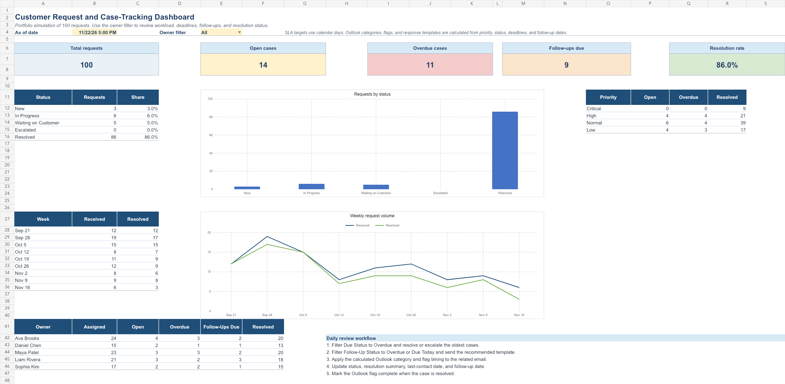
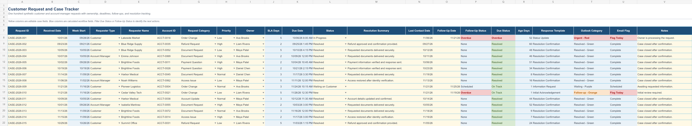
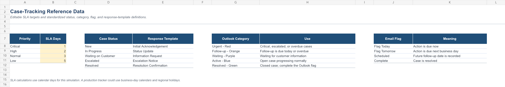

# Customer Request and Case-Tracking System

An Excel portfolio project that simulates how a data-operations team organizes, prioritizes, follows up on, and resolves customer and account-manager requests.

All records are synthetic. The workbook and supporting Outlook guide contain no real customer, employee, or employer data.

## Project objective

The project demonstrates how an operations team can:

- Maintain a structured tracker for 100 incoming requests
- Assign priorities and owners
- Apply priority-based service-level targets
- Calculate deadlines, case age, and follow-up status
- Identify overdue cases and follow-ups due today
- Document resolution summaries and last-contact dates
- Select a consistent response template based on case status
- Map cases to Outlook categories and flag timing
- Report workload and resolution results by status, priority, week, and owner

## Workbook

Download [Customer_Request_and_Case_Tracking_System.xlsx](Customer_Request_and_Case_Tracking_System.xlsx) and open it in Microsoft Excel.

The workbook contains three worksheets:

1. **Dashboard** - owner filter, KPI cards, status and priority summaries, weekly volume, owner workload, and the daily review workflow
2. **Case Tracker** - 100 fictional requests with editable case fields and formula-driven workflow controls
3. **Reference Data** - SLA targets and standardized response-template, Outlook-category, and email-flag definitions

## Excel skills demonstrated

- `INDEX` and `MATCH` for SLA and response-template retrieval
- `COUNTIFS` for dashboard metrics and owner-filtered reporting
- Nested `IF`, `AND`, and `OR` logic for workflow classification
- Date arithmetic for deadlines, age, and follow-up monitoring
- Excel tables, filters, frozen panes, and dropdown validation
- Conditional formatting for overdue, due-soon, on-track, and resolved cases
- Formula-linked status and weekly-volume charts

## Formula-driven fields

The Case Tracker calculates:

- Week start
- SLA target days
- Due date
- Follow-up status
- Due status
- Case age
- Recommended response template
- Outlook category
- Email flag timing

## Results at the reporting cutoff

| Metric | Result |
| --- | ---: |
| Total requests | 100 |
| Open cases | 14 |
| Overdue cases | 11 |
| Follow-ups due | 9 |
| Resolved cases | 86 |
| Resolution rate | 86.0% |

## Outlook workflow guide

The [Outlook Request Management Workflow](Outlook_Request_Management_Workflow.pdf) documents:

- Suggested inbox rules for customer, account-manager, urgent, and waiting-for-information requests
- Outlook category definitions
- Flag timing standards
- A daily email and case-review checklist
- Initial acknowledgement, status update, information request, escalation, and resolution templates
- An interview demonstration sequence

## Screenshots

### Dashboard

### Case tracker

### Reference data

## Suggested review workflow

1. Review the Dashboard KPIs and owner filter.
2. Open Case Tracker and filter `Due Status` to `Overdue`.
3. Filter `Follow-Up Status` to `Overdue` or `Due Today`.
4. Inspect how priority selects the SLA target and calculates the due date.
5. Review the recommended response template, Outlook category, and email flag.
6. Change a case to `Resolved` and enter its resolution summary to observe the workflow fields update.

## Resume bullet

- Organized and prioritized 100 simulated customer requests using a structured case tracker, monitoring ownership, deadlines, follow-ups, and resolution status to prevent overdue items.

## Limitations and possible extensions

This project is a static portfolio simulation rather than a production case-management system. Potential extensions include importing Outlook data through Power Query, using business-day SLA calendars, protecting formula columns, recording historical status changes, and connecting the tracker to a ticketing or customer-account platform.

## Disclaimer

This independent portfolio project uses fictional requests for learning and demonstration purposes. It does not represent customer-service or account-management work performed for a real employer or client.
